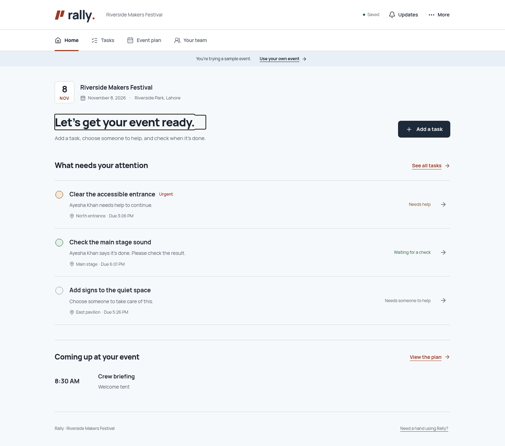
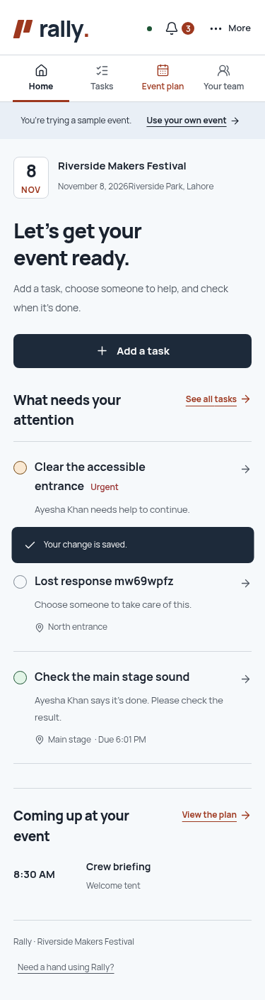
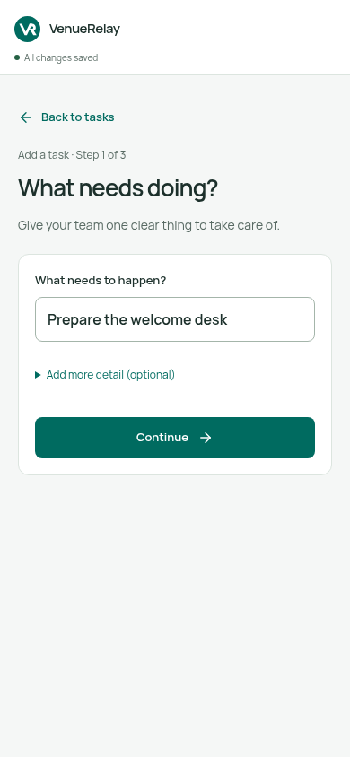
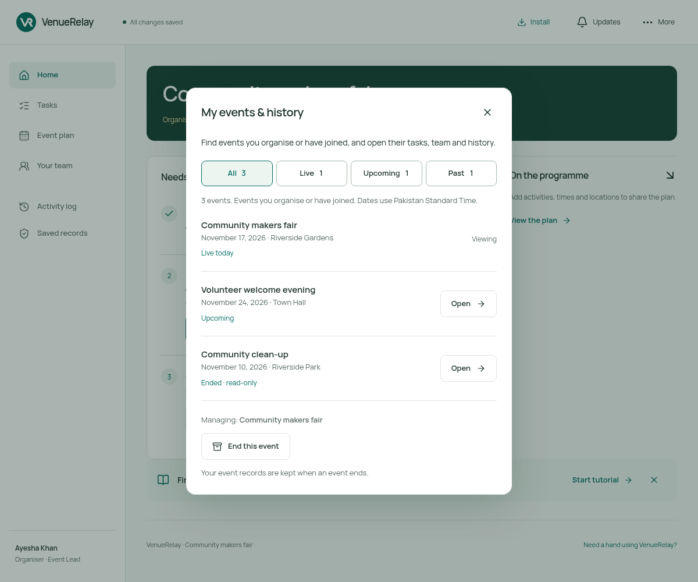
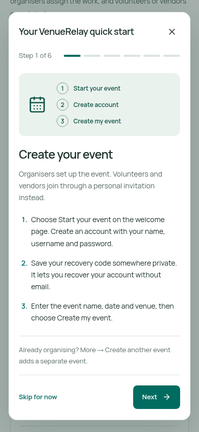
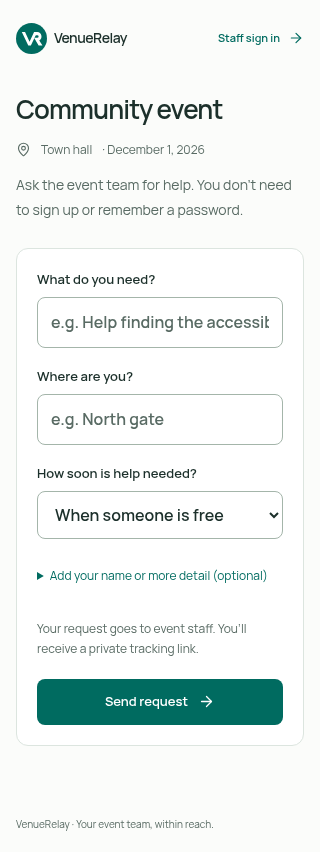

  

  # VenueRelay

  **Every team. Every update. One place.**

  An event workspace that turns attendee requests into coordinated, completed work.

  <a href="https://venuerelay.onrender.com">Open the demo</a>

   

  
  
  
  

 

  

## What it does

- **Keeps the whole team coordinated.** Organisers, volunteers and vendors each have a clear role.
- **Turns requests into owned work.** Attendees can request help from a QR code without creating an account. Staff can assign, track and review the work.
- **Keeps event information together.** Share the programme, receive team updates, and find live, upcoming and past events.
- **Works well on phones.** Install VenueRelay from the browser and continue with cached event details when the connection drops.

  
<strong>More screenshots</strong>

   

  
  
  
  
  

## Run locally

Install [Node.js 24](https://nodejs.org/) and Git. Then:

~~~sh
git clone https://github.com/thehusnain/VenueRelay.git
cd VenueRelay
npm install
npm run dev
~~~

Open **http://127.0.0.1:3001** when the terminal says **VenueRelay is ready**. Choose **Explore the demo** to start right away. The local SQLite database is created automatically; no environment file or external service is needed. Press **Ctrl+C** to stop.
