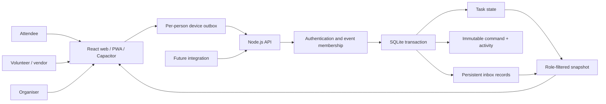

# Architecture and correctness

## Runtime

React 19, TypeScript and Vite render the web UI. A Node.js 24 HTTP service owns authentication, permissions and all durable records. SQLite uses WAL mode, foreign keys, a 5-second busy timeout and `synchronous=FULL`. It is suited to one small organiser deployment on a persistent local disk. Horizontal replicas with separate disks are not supported; a multi-region deployment would need a shared transactional database.

## Write protocol

1. The client generates one random intent ID and saves the complete action to a separate local-storage key before sending. Separate keys prevent one tab from overwriting another tab’s entire outbox.
2. The server authenticates the request, resolves event membership and ignores client attempts to choose the actor or reporter.
3. `BEGIN IMMEDIATE` serialises the write transaction. Nested operations use savepoints. All task-version and ownership checks occur inside the transaction.
4. A unique `(actor_id, request_key)` journal constraint protects retries. The normalised request hash must match. Replays return the original result; a key reused for different data returns 409.
5. A task update supplies its expected version. A stale version returns 409 with the current record; no state, audit or notifications are committed for that rejected attempt.
6. The task change, immutable request result, activity before/after snapshot and notification rows are written in the same transaction. Any exception rolls all of them back.
7. Only a successful response removes the device outbox item. A lost response can be retried safely. A conflict stays visible until explicitly discarded or reapplied using a new intent ID and the latest version.

The canonical task view always comes from a server snapshot. Offline commands are labelled pending rather than represented as confirmed changes. Multiple workers may submit duplicate HTTP requests; the server accepts the intent once. This provides exactly-once effects for a retained intent ID, not exactly-once network delivery.

## Permissions

| Operation                               | Organiser         | Assigned volunteer/vendor       | Attendee/reporter |
| --------------------------------------- | ----------------- | ------------------------------- | ----------------- |
| Read event schedule and announcements   | Yes               | Yes                             | Yes               |
| Create own help request                 | Yes               | Yes                             | Yes               |
| Read all tasks                          | Yes               | Own assignments and own reports | Own reports       |
| Assign/reassign work                    | Yes               | No                              | No                |
| Start, block or resolve work            | Yes               | Own assignment only             | No                |
| Verify closure or reopen                | Yes               | No                              | No                |
| Invite members / issue or revoke tokens | Signed-in account | No                              | No                |
| Export complete audit / integrity check | Yes               | No                              | No                |

The demo selector is an owner-only sandbox facility. Sending a persona header against a real event is rejected, even for the owner. Invitation tokens bind an authenticated user to a fixed role and event. Event-level integration tokens inherit their issuing organiser’s operational access but cannot create invitations, issue additional tokens or revoke tokens.

## History and notifications

Activity and request journal rows are protected by SQL triggers that reject update and delete operations. Each accepted operational command has exactly one activity entry. Task versions equal the number of accepted task operations. Integrity checks compare those counts and run `foreign_key_check`.

Operational actions covered by this journal include task changes, programme creation, announcements, invitations, membership joins, token issuance and token revocation. Account/session creation and initial event metadata provisioning are outside the operational task journal. Inbox read acknowledgements are naturally idempotent and preserve the first read time.

Database administrators can replace the database or remove triggers; the log is append-only under the application/schema contract, not cryptographic proof against a privileged administrator. Routine backups are still required.

Notification recipients are the task reporter, assigned owner, former owner on reassignment and organisers, excluding the acting person. Announcements notify all other event members. Recipients and the activity entry are committed with the task mutation. Notification records remain available on a later device/session; the current snapshot returns the most recent 100.

## Failure boundaries

| Failure                             | Behaviour                                                                 |
| ----------------------------------- | ------------------------------------------------------------------------- |
| Wi-Fi unavailable before submit     | Device outbox retains the intent; canonical records stay unchanged        |
| Page reload during outage           | Cached app shell and last snapshot reopen; outbox survives                |
| Server commits but response is lost | Same intent is replayed; no duplicate task, log or notification           |
| Two organisers act on one version   | One succeeds; the other receives 409 and must review                      |
| Permission changes before reconnect | Server reevaluates access; rejected action remains for review             |
| Storage exception inside a command  | Entire command transaction rolls back                                     |
| Node process/database restart       | Committed records and idempotency results persist                         |
| Device storage unavailable/full     | New action is not sent; user is told to free storage and retry            |
| Device data is cleared before sync  | Unconfirmed local actions are lost; server-confirmed records remain       |
| Session expires while offline       | Renew the same registered account to sync; demo sessions have no recovery |

The app does not sync while it is closed. Polling is near-real-time (three-second target while visible); it is not a WebSocket/SSE service. An outage on a device that has never opened the event cannot produce a previously cached workspace.

## Accounts and delivery

Versioned `PRAGMA user_version` migrations preserve existing records and reject a database with a newer schema. Existing email addresses are not assumed verified during an upgrade. Verification and reset proofs are random, hashed, expiring and single-use. Password-reset consumption, password update and session revocation share one transaction. Account security events have their own append-only journal.

Registration and its email-outbox enqueue are atomic. Delivery runs after commit; jobs use a lease and recover after worker interruption. A stable Message-ID and backoff support SMTP retries, but remote delivery is at-least-once. Delivered bodies are cleared; obsolete proofs are cancelled rather than endlessly retried. Local preview files are explicitly labelled and are private files, not a public endpoint.

## Interface and native app

Public welcome and explicit sample access precede the workspace. Real accounts confirm email and create or join an empty event. Full-page steps retain data on Back; short dialogs trap and restore focus. Home presents at most three next tasks. Connection recovery and technical details are progressively disclosed under More.

The PWA caches the web shell; a native Capacitor build bundles it and skips service-worker registration. Both share the per-person device outbox. The Android local demo uses USB reverse port forwarding to reach the Node server on the computer. The APK does not contain a Node server or a separate authoritative event database.
